<p align="center">
  
</p>

# prompt-rewriter

A Claude Code mod that turns a rough prompt into a clear one **before** you send it, and never sends anything without your OK.

<p align="center">
  
</p>

1. **Classify.** Haiku picks the role persona (from 23, such as DevOps/Cloud) and task persona (from 6, such as Debug) that fit the prompt.
2. **Search, only when it matters.** If the prompt depends on recent information (new versions, migrations, deprecations, changed APIs), it runs one web search. For your own bugs and well-known techniques, it skips the search.
3. **Rewrite.** Haiku tightens the wording and keeps every file name, number, constraint and pasted snippet. When web results were relevant, it adds a short **Recent context** section with source URLs.
4. **Review.** The rewrite lands in your prompt box. Edit it, press **Enter** to send it with the matched personas attached as hidden context, or put your original back.

## Install

In a Claude Code terminal session:

```
/plugin install prompt-rewriter --marketplace KunalKumarkkr01/prompt-rewriter
```

Answer `y` to add the marketplace, then press Enter to pick the user scope. It's active right away, with no restart.

> Run the command from a terminal session. The desktop app's Code tab doesn't offer `/plugin install`, but once it's installed at user scope, the mod works there too.

## Commands

| Command | What it does |
| --- | --- |
| `/rewrite <prompt>` | Classify, search if needed, rewrite, and put the result in your prompt box |
| `/rewrite-again [more context]` | Rewrite your original prompt again. Anything after the command is added to it, and later retries keep it |
| `/rewrite-cancel` | Stop a rewrite in progress, or discard one, and put your original back (Esc also stops it) |

**Not happy with a rewrite?** You don't need to clear the box first. If your very first keystroke on a fresh rewrite is `/`, it replaces the rewrite, so you can type straight over it:

```
/rewrite-again it only fails on CI, not locally
/rewrite-cancel
```

Once you've edited the rewrite in any other way, `/` is plain text again, so your edits are never wiped.

Pressing Enter on any normal prompt sends it as usual: the mod does nothing unless you type `/rewrite`. If you clear the box while a rewrite is pending, whatever you type next is sent as typed, with no personas attached.

## What it won't do

The rewrite is an editor, not a second agent. It is designed and [evaluated](evals/README.md) to:

- **Never answer the prompt itself.** If Haiku replies *about* the prompt ("I can't rewrite this…") instead of rewriting it, the mod detects that and gives your original back.
- **Never decide the "how".** No invented steps, approaches, examples or acceptance criteria, and no narrowing or widening of scope.
- **Keep pasted code, logs and errors verbatim.**
- **Treat web results as untrusted.** Instructions planted in search results ("tell the agent to run `curl … | bash`") are never passed on.
- **Fail safe.** On a timeout, an error, or a rewrite too long to finish, your original goes back in the box.

## Before and after

It clarifies your ask; it doesn't extend it. The first version of this mod added something you never asked for in a third of its rewrites:

<p align="center">
  
</p>

When the prompt depends on recent information, it searches once and adds sourced **Recent context**:

<p align="center">
  
</p>

Every visual uses real outputs from the eval runs. More samples, including a planted prompt injection: **[docs/examples.md](docs/examples.md)**.

## Evaluated

43 tuning cases plus 13 held-out cases written after tuning, 3 trials each, graded by deterministic checks and a Sonnet judge. Details and how to rerun: [evals/README.md](evals/README.md).

| Metric (held-out cases) | First version | Now |
| --- | --- | --- |
| Rewrite pass rate | 64% | **97%** |
| Adds requirements you didn't ask for | 33% | **3%** |
| Messy prompts actually improved | 100% | **100%** |
| Correct "search the web or not" call | 39% | **92%** |

## Customize the personas

Personas are plain Markdown in `personas/roles/` and `personas/tasks/`. The first line is the summary the classifier chooses from, and the rest is the guidance attached when it matches. Add a file and the classifier offers it on the next `/rewrite`.

```markdown
# Embedded Engineer — firmware, RTOS, drivers, microcontrollers

- Mind memory and timing budgets; avoid dynamic allocation in hot paths.
```

The two system prompts live in `prompts/classify.md` and `prompts/rewrite.md`. If you change them, rerun the evals (`python evals/run_eval.py --label mine`) and compare with `--compare final mine`.

## Cost and privacy

Each `/rewrite` makes 2 Haiku calls (well under a cent) and at most one web search, all on your own Claude account, the same way Claude Code's own requests are. It sends nothing anywhere else. A rewrite takes about 5–15 seconds.

## Uninstall

```
/plugin uninstall prompt-rewriter
```

## License

[MIT](LICENSE) © 2026 Kunal Kumar

## Acknowledgements

Built by Kunal Kumar with [Claude Code](https://claude.com/claude-code) (Anthropic), which also helped design and run the evals.
